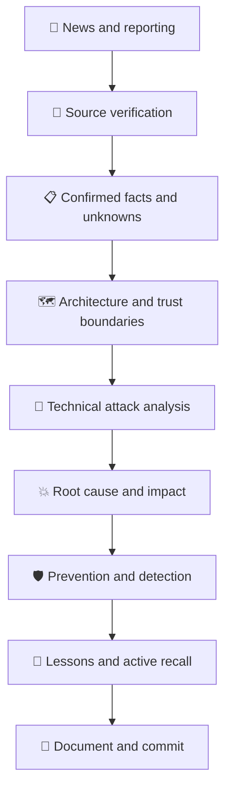

# 🔐 Security Field Notes

<p align="center">
  
</p>

<p align="center">
  
  
  
  
</p>

> **Understand the incident. Reconstruct the attack. Verify the evidence. Engineer the defense.**

Security Field Notes is a living cybersecurity research journal dedicated to transforming real-world security incidents into technical knowledge and practical defensive strategies.

This repository connects cybersecurity news, original reporting, technical advisories, multimedia sources, attack-chain analysis, threat modeling, and prevention engineering.

The goal is not merely to follow security news. It is to understand the systems behind it, question the available evidence, and learn how to prevent similar failures.

---

## 🧭 Research Mission

Every incident is an opportunity to understand how systems fail, how attackers exploit weaknesses, and how defenders can reduce risk.

This project follows five principles:

- **Evidence over assumptions:** distinguish confirmed facts, reasonable hypotheses, and unknowns.
- **Mechanisms over headlines:** investigate the underlying technical failure.
- **Impact over labels:** explain what an attack actually enables.
- **Prevention over speculation:** translate findings into actionable security controls.
- **Continuous learning:** connect real incidents to application security, ethical hacking, and security research.

## 📡 Daily Cybersecurity Intelligence

Each daily briefing combines current reporting with deeper technical investigation.

| Layer | Research objective |
|---|---|
| 📰 News | Understand what happened and who was affected |
| 🎥 Multimedia | Review relevant reporting, interviews, footage, and technical presentations |
| 📚 Primary sources | Verify claims against official advisories and vendor documentation |
| 🔬 Technical analysis | Examine architecture, trust boundaries, vulnerabilities, and attack paths |
| 🛡️ Prevention | Identify hardening, monitoring, containment, and recovery measures |
| 🧠 Active recall | Test understanding instead of passively rereading notes |
| 🌍 Technical English | Build the ability to explain security concepts clearly |

## 🔎 Featured Case Study

### French Supermarket Refrigeration Controller Incident

**October 2026 · Operational Technology Security**

Reports described compromises involving connected refrigeration controllers used by French supermarkets. The incident highlights the potential physical and business consequences of insecure remote management.

**Research questions:**

- How were the affected controllers managed remotely?
- Which trust boundaries protected the controllers?
- What does the public evidence establish about the attack path?
- Which access controls and network restrictions reduce the risk?
- How should defenders monitor unauthorized configuration changes?
- What remains unknown from the available reporting?

**Explore the sources:**

- [CERT-FR technical advisory](https://www.cert.ssi.gouv.fr/alerte/CERTFR-2026-ALE-012/)
- [The Guardian's incident reporting and video](https://www.theguardian.com/world/2026/oct/12/cyber-attack-defrosts-refrigerators-france-supermarket-chains-intermarche-cooperative-u)

**Analysis standard:** A plausible attack path is not a confirmed attack path. Each proposed step must be supported by evidence or explicitly labeled as a hypothesis.

## 🧬 How an Incident Becomes a Case Study



This is the research workflow, not a claim that every incident follows the same technical attack sequence.

## 🗂️ Repository Architecture

```text
security-field-notes/
│
├── README.md
├── daily-briefings/
│   └── YYYY-MM-DD-day-NN.md
│
├── incidents/
│   └── YEAR/
│       └── incident-name/
│           ├── README.md
│           ├── timeline.md
│           ├── technical-analysis.md
│           ├── attack-chain.md
│           ├── prevention.md
│           ├── sources.md
│           └── media/
│               ├── README.md
│               ├── videos.md
│               ├── images/
│               └── diagrams/
│
├── technical-analysis/
│   ├── trust-boundaries/
│   ├── ot-security/
│   └── web-security/
│
├── prevention-and-detection/
├── ethical-hacker-stories/
├── active-recall/
├── sources/
└── progress/
```

## 🎥 Multimedia Research

Visual evidence and explanations can reveal details that a headline cannot. Every incident may include:

- News reports and interviews from reputable publishers.
- Original video coverage, with relevant timestamps.
- Official advisories and vendor technical demonstrations.
- Architecture diagrams and attack-chain visualizations.
- Photographs of relevant systems, clearly labeled as actual incident evidence or illustrative material.

### Media standards

1. Link to original reporting whenever possible.
2. Record the publisher, publication date, and original URL.
3. Distinguish eyewitness footage from technical evidence.
4. Do not present illustrative images as photographs of the actual incident.
5. Respect copyright and licenses. Publicly viewable does not mean free to redistribute.
6. Explain what each visual supports and what it cannot establish.

## 🛡️ Technical Research Domains

| Domain | Focus |
|---|---|
| Web application security | Input handling, sessions, access control, and business logic |
| API security | Authentication, authorization, BOLA/IDOR, and API trust boundaries |
| Vulnerability research | Root causes, exploit prerequisites, and security impact |
| Operational technology | Industrial systems, remote management, and network segmentation |
| Threat modeling | Assets, actors, attack surfaces, trust boundaries, and controls |
| Defensive security | Hardening, logging, monitoring, incident response, and recovery |

## 📜 Evidence Classification

Every incident analysis distinguishes three categories.

| Classification | Meaning |
|---|---|
| **Confirmed** | Directly supported by reliable documentation or reproducible evidence |
| **Inferred** | A plausible explanation consistent with the evidence but not established as fact |
| **Unknown** | Available information is insufficient to reach a reliable conclusion |

The same standard applies to root cause, initial access, attacker behavior, impact, and attribution.

## 🧑‍💻 Ethical Hacker Stories

Security progress is made by people who identify weaknesses, investigate difficult problems, and help make systems safer.

This section documents real researchers, responsible disclosures, major vulnerabilities, and the human consequences of security work.

Each story should include verified sources, the technical discovery, its significance, and lessons for future researchers. No invented heroics or mythology required.

## 🧠 Learning and Active Recall

Daily learning is organized around questions that require explanation and reasoning.

- What security boundary failed?
- Which assumptions did the system trust?
- What evidence supports the proposed attack path?
- What alternative explanations remain?
- How could the weakness be prevented or detected?
- What would constitute a minimal, convincing proof of impact?

The goal is to build independent technical judgment, not just collect vocabulary.

## 📅 Research Log

**Learning period:** 15 October 2026 – 15 December 2026

| Day | Date | Focus | Status |
|---|---|---|---|
| 01 | 2026-10-15 | Trust boundaries, OT incident analysis, Heartbleed | Completed |
| 02 | 2026-10-16 | To be documented | Pending |

The detailed progress tracker lives in [`progress/`](progress/).

## ⚖️ Ethics and Scope

All active security testing must be explicitly authorized and remain within the applicable program scope.

This repository focuses on responsible research, minimal proof of impact, careful evidence handling, and practical defense. Sensitive data, credentials, and unauthorized private information must never be committed.

## 🚀 Long-Term Objective

Build a searchable, evidence-driven cybersecurity knowledge base that improves incident analysis, vulnerability research, defensive engineering, and technical communication.

**The standard is simple: understand the system, verify the claim, explain the mechanism, and recommend a defense.**

---

<p align="center">
  <sub>Built through daily study, technical curiosity, and disciplined research.</sub>
</p>

