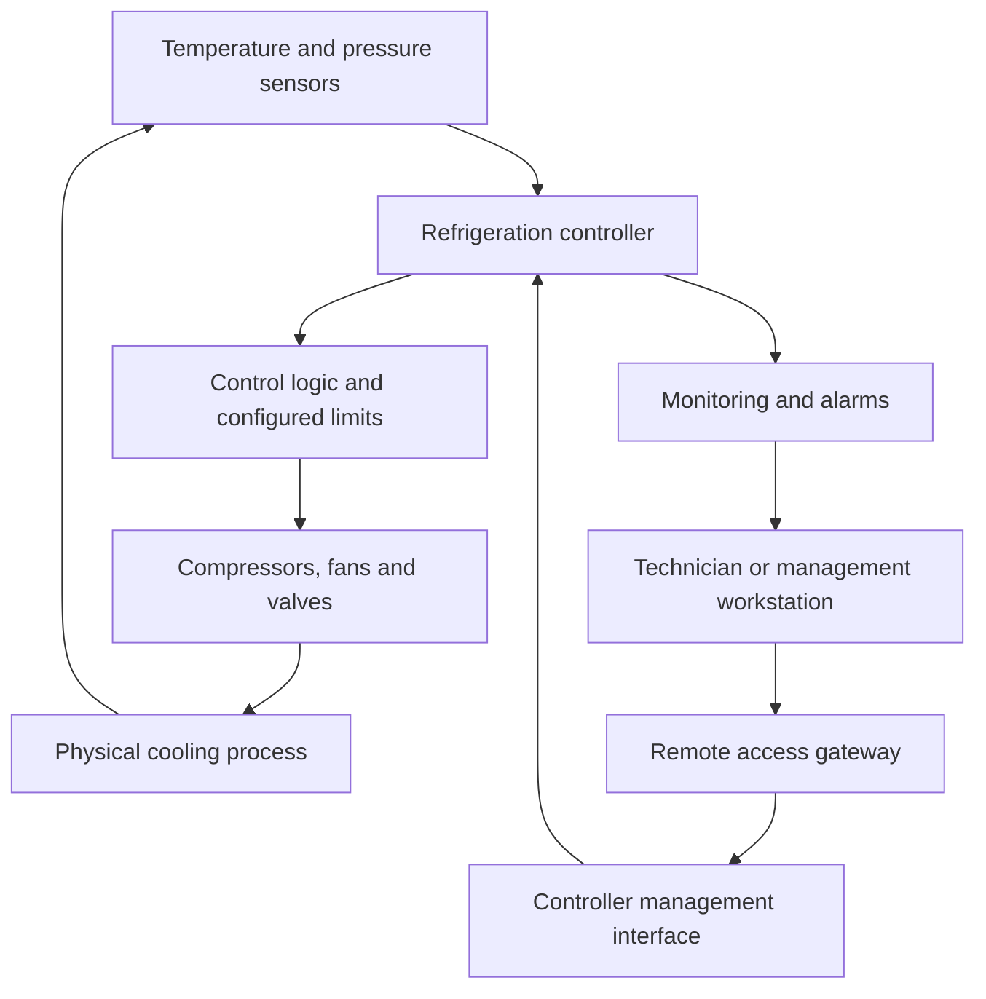
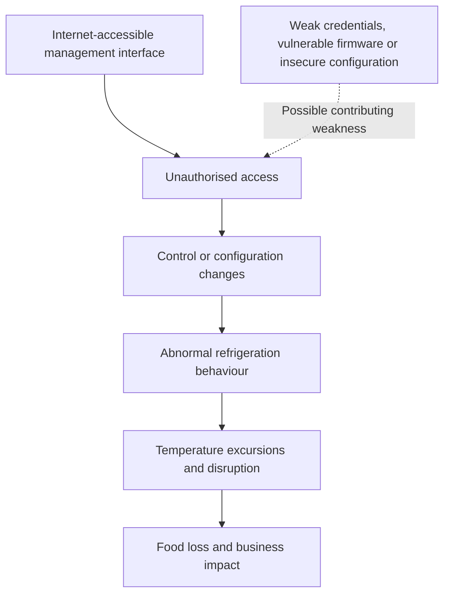

# When Refrigeration Systems Become an Attack Surface
### Cybersecurity Incident Analysis: French Supermarket Refrigeration Controllers
**Publication date:** 15 October 2026  
**Category:** Operational Technology Security · Industrial Control Systems · Incident Analysis

---

## News Report: Cyberattacks Disrupt Supermarket Refrigeration in France

French supermarkets experienced a significant cybersecurity incident in October 2026 after attackers compromised remote controllers used to manage refrigeration equipment. The incident disrupted temperature regulation across multiple retail locations, resulting in spoiled food, operational disruption and reported fires.

France’s national cybersecurity agency, CERT-FR, published advisory **CERTFR-2026-ALE-012** on 12 October and updated it on 13 October. The advisory confirmed numerous compromises involving remote refrigeration controllers associated with Danfoss AK-SC and AK-SM series equipment, as well as Copeland XWEB and Dixell XWEB systems.

Reuters reported that hundreds of supermarkets were affected. Public reporting described refrigeration temperatures rising dramatically, including reported readings of up to 50°C in some locations. These figures describe reported outcomes, not a verified measurement for every affected installation. The number of affected stores and the precise financial impact also vary between reports.

The incident demonstrates how compromising a relatively specialised control system can produce consequences far beyond the digital environment. Refrigeration controllers are not ordinary office computers: they influence physical processes, food safety, equipment operation and business continuity.

CERT-FR warned that exposing management interfaces directly to the public internet violates established security practices. Its guidance recommends removing unnecessary internet exposure, restoring compromised devices, restricting remote access to protected networks or secure VPN connections, and applying appropriate firmware and configuration updates.

As of the cited reporting, the public evidence did not establish one complete attack chain for every affected site. The initial access method, the exact tools used by the attackers, and whether every compromise shared the same cause should therefore remain open investigative questions rather than assumed facts.

**Primary sources**

- [CERT-FR: Incident affecting remote refrigeration controllers](https://www.cert.ssi.gouv.fr/alerte/CERTFR-2026-ALE-012/)
- [Reuters: Hackers heat French supermarket fridges, causing food losses](https://www.investing.com/news/stock-market-news/hackers-heat-french-supermarket-fridges-sparking-fires-and-food-losses-4944916)
- [Reuters: Copeland and Dixell refrigeration systems also compromised](https://www.reuters.com/business/retail-consumer/copeland-dixell-refrigeration-systems-also-hacked-french-cybersecurity-agency-2026-10-13/)
- [The Guardian: Reporting and video from the incident](https://www.theguardian.com/world/2026/oct/12/cyber-attack-defrosts-refrigerators-france-supermarket-chains-intermarche-cooperative-u)

---

## Technical Lecture: The Security of Operational Technology

### 1. From Information Systems to Physical Processes

Traditional information technology (IT) primarily processes, stores and communicates information. Operational technology (OT) monitors or controls physical equipment and industrial processes.

A corporate IT compromise may expose documents, interrupt email or enable unauthorised access to business applications. An OT compromise can change how machinery operates, disrupt production, damage equipment or affect the safety and quality of physical goods.

Refrigeration controllers occupy this boundary between software and the physical world. Depending on the installation, they may monitor temperature sensors, coordinate compressors, manage defrost cycles, report alarms and accept configuration changes from remote operators.

The security objective is consequently broader than confidentiality alone. Availability and integrity are essential, and safety-related consequences must be considered when evaluating the impact of unauthorised control.

### 2. How a Refrigeration Control System Works

A typical refrigeration control environment contains several interacting components:

- **Sensors:** Measure conditions such as temperature and pressure.
- **Controller:** Applies configured rules to sensor readings and operating parameters.
- **Actuators and equipment:** Compressors, fans, valves and other components perform physical actions.
- **Supervisory interface:** Allows technicians to inspect status, modify settings and manage equipment.
- **Remote maintenance path:** Connects the installation to an external technician, service provider or management platform.

A simplified architecture is shown below.

The controller does not need to be compromised at the operating-system level for an attacker to cause harm. If an unauthorised party can modify legitimate control parameters, the equipment may execute those settings using its normal functionality.

This is a crucial distinction: **an attacker can misuse an authorised feature without exploiting a software memory-corruption vulnerability.**

### 3. The Management Interface as a Trust Boundary

A management interface is a security boundary because it allows an external identity or system to influence a device's behaviour.

Direct internet exposure increases the number of parties able to reach that boundary. It also places greater pressure on authentication, authorisation, configuration and patch management.

A secure design should distinguish between the public internet, the organisation's business network, the remote-maintenance environment and the OT control network. Access between these zones should be deliberately restricted rather than permitted by default.

A VPN can protect a remote connection, but it does not automatically make the connected endpoint trustworthy. Compromised technician accounts, overly broad VPN permissions, weak device authentication or unrestricted network routing can still permit unauthorised control.

Effective protection therefore requires multiple layers: controlled network reachability, strong authentication, least-privilege permissions, secure device configuration, supported firmware and monitoring of sensitive changes.

### 4. The Difference Between Exposure, Vulnerability and Compromise

These terms describe different security conditions and should not be treated as synonyms.

**Exposure** means a service or interface can be reached by an unauthorised or insufficiently trusted party. Exposure increases opportunity but does not prove successful intrusion.

**Vulnerability** means a weakness can be exploited under particular conditions. The weakness may exist in software, configuration, authentication or the design of a system.

**Compromise** means an attacker has achieved unauthorised access or control. Establishing compromise requires evidence beyond the discovery of an exposed interface.

A device may be exposed without being vulnerable to a particular exploit. A vulnerable device may remain uncompromised. A compromised device may have been accessed through weak credentials or misconfiguration rather than a software vulnerability.

This distinction matters during incident response. Discovering an exposed controller does not, by itself, identify the initial access method. Likewise, restoring the device to factory settings does not establish that its underlying security weaknesses have been removed.

### 5. Reconstructing the Incident Without Inventing an Attack Chain

The available evidence supports a limited but important conclusion: remote refrigeration controllers from several product families were compromised, and the incident had physical and operational consequences.

A plausible attack path is:

The dashed relationship represents a hypothesis, not a confirmed finding for every affected system. Publicly available reporting does not establish that all devices were accessed in the same way.

A forensic investigation would seek evidence from controller access logs, configuration histories, authentication events, remote-maintenance gateways, network telemetry and technician activity records. Investigators would compare the timeline of unauthorised access with changes to operating parameters and subsequent temperature anomalies.

The central analytical question is not merely whether the equipment was online. It is how an unauthorised actor crossed the relevant trust boundary, obtained permission or control, changed system behaviour, and remained undetected long enough to cause damage.

### 6. Why the Impact Extended Beyond the Network

The incident illustrates a cyber-physical impact chain:

**Unauthorised digital control → altered equipment behaviour → physical temperature change → loss of perishable goods → financial and operational disruption.**

The initial intrusion does not need to destroy data or encrypt servers to cause substantial harm. Manipulating a small number of critical parameters may be sufficient when those parameters govern a physical process.

The consequences also depend on the surrounding environment. Monitoring quality, alarm thresholds, human response times, the number of connected stores, the availability of manual controls and the time required to restore safe operation can all affect the final impact.

This is why OT risk assessments must account for the function of the equipment, not merely its software version or network address.

### 7. Prevention, Detection and Recovery

The CERT-FR response emphasises reducing exposure and restoring compromised equipment safely. Remote refrigeration management should be reachable only through an appropriately protected access path, with unnecessary public exposure removed.

Device firmware and security settings should follow the manufacturer's supported recommendations. Default credentials must be replaced, remote access should be restricted to authorised users and systems, and unsupported devices require particular attention because a reset cannot repair an unpatched weakness.

Monitoring should include unexpected changes to operating parameters, unusual remote sessions, modifications outside approved maintenance windows, loss of normal telemetry and discrepancies between configured settings and observed physical conditions. Where feasible, security events should be correlated with independent temperature measurements and operational alarms.

Recovery must address both the digital and physical state of the installation. A factory reset may remove unauthorised configuration or persistence, but it is not sufficient when the same vulnerable configuration is restored or the device remains exposed. Reconnection should follow secure reconfiguration, access restrictions and verification that the equipment operates safely.

In OT environments, containment decisions also require operational coordination. Abruptly disconnecting a device or disabling remote monitoring may interfere with maintenance, visibility or safe operation. Incident response should involve cybersecurity personnel and the technicians responsible for the physical process.

---

## Broader Security Implications

The incident reflects a wider architectural problem: specialised equipment is increasingly connected to remote maintenance and management services, while its security controls may not receive the same attention as conventional enterprise systems.

The risk is not limited to supermarkets. Similar trust-boundary questions arise in building management systems, water treatment, manufacturing, healthcare facilities, energy systems and transport infrastructure.

The common issue is the relationship between remote access and physical authority. A network connection that permits observation may have different consequences from one that permits configuration changes. Security architecture should separate these capabilities and grant only the permissions required for each operational role.

The appropriate measure of security is therefore not simply whether a device is connected, patched or monitored. It is whether unauthorised parties can influence a critical process, whether such influence can be detected, and whether the organisation can restore safe operation without repeating the conditions that enabled the incident.

## Assessment

The French refrigeration incident demonstrates that operational impact can arise from the misuse of connected control systems even when public evidence does not establish a sophisticated exploit or a single universal intrusion method.

The strongest documented conclusion is that multiple refrigeration-controller product families were compromised and that direct internet exposure of management interfaces is a central security concern identified by France's national cybersecurity authority.

The exact initial access vector and the detailed sequence of attacker actions remain matters for evidence-led investigation. Maintaining that distinction between documented facts and plausible explanations is essential to credible incident analysis.

The broader lesson is architectural: systems that control physical processes must be treated as security-critical assets, with deliberate trust boundaries, tightly controlled remote access, secure configurations, meaningful monitoring and recovery procedures that address the underlying weakness rather than only its immediate symptoms.

---

## References

1. **CERT-FR**, *Incident de sécurité ciblant les contrôleurs à distance des installations de réfrigération*, advisory CERTFR-2026-ALE-012, first published 12 October 2026, updated 13 October 2026.  
   https://www.cert.ssi.gouv.fr/alerte/CERTFR-2026-ALE-012/

2. **Reuters**, *Hackers heat French supermarket fridges, sparking fires and food losses*, 12 October 2026, updated 13 October 2026.  
   https://www.investing.com/news/stock-market-news/hackers-heat-french-supermarket-fridges-sparking-fires-and-food-losses-4944916

3. **Reuters**, *Copeland, Dixell refrigeration systems also hacked, French cybersecurity agency says*, 13 October 2026.  
   https://www.reuters.com/business/retail-consumer/copeland-dixell-refrigeration-systems-also-hacked-french-cybersecurity-agency-2026-10-13/

4. **The Guardian**, *Cyber-attack defrosts refrigerators at French supermarket chains*, 12 October 2026.  
   https://www.theguardian.com/world/2026/oct/12/cyber-attack-defrosts-refrigerators-france-supermarket-chains-intermarche-cooperative-u

**Source methodology:** Official advisories establish the confirmed technical scope and recommended mitigations. News reports provide operational context and reported consequences. Proposed attack paths are explicitly identified as hypotheses where primary evidence does not confirm them.
