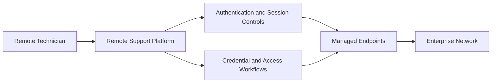
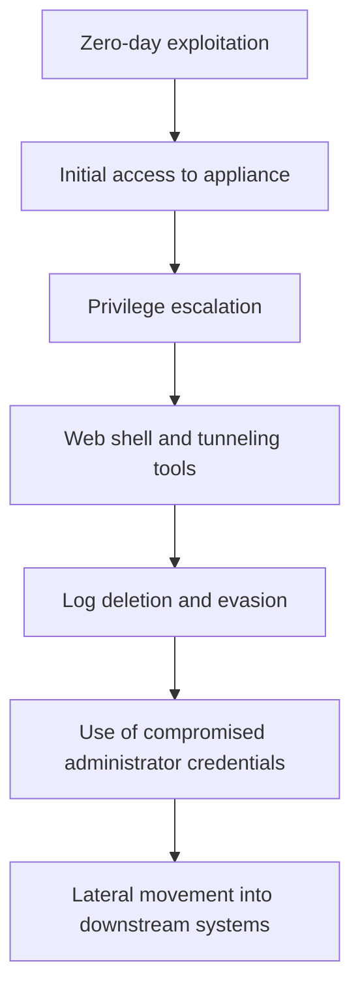

# BeyondTrust Remote Support: A Zero-Day Becomes an Enterprise Entry Point

**Publication date:** 16 October 2026  
**Category:** Vulnerability Analysis · Enterprise Security · Threat Intelligence

## 1. News Report

On 15 October 2026, BeyondTrust publicly disclosed a critical vulnerability in its Remote Support product after confirming that attackers had exploited it before disclosure.

Tracked as **CVE-2026-102764**, the vulnerability received a CVSS v4.0 score of 9.3. BeyondTrust describes the underlying issue as improper origin validation in an internal messaging component. Under certain conditions, a remote attacker could perform file operations on an affected appliance.

Google Threat Intelligence Group and Mandiant linked the observed activity to a suspected China-nexus espionage actor known as **ARMORY CASTLE**. CrowdStrike tracks the associated activity as WARP PANDA. Attribution remains an intelligence assessment rather than a publicly proven identity.

Public reporting describes a broader intrusion sequence involving privilege escalation, deployment of web-shell and tunneling tools, log deletion, and lateral movement using compromised administrator credentials.

The vulnerability affects BeyondTrust Remote Support versions 26.2.3 and earlier. BeyondTrust released the BT26-05 patch on 8 October, before its public disclosure on 15 October. SaaS instances were patched by the vendor; self-hosted customers may need to apply the patch manually.

**Primary references:** BeyondTrust security advisory BT26-05; BeyondTrust's technical blog; Mandiant and Google threat-intelligence reporting; Reuters.

## 2. Technical Lecture: Remote Support as a Trust Boundary

Remote-support platforms allow authorized technicians to access user devices and troubleshoot systems. Their privileged position makes them valuable administrative tools, but also high-value targets.

A typical environment can be represented as:

The platform sits between external operators and internal systems. If its security controls fail, the attacker may gain access to an intermediary that already possesses trusted relationships with other assets.

The key issue is not simply whether a support appliance is exposed to the internet. It is what that appliance can access, which credentials it stores or brokers, and what privileges its processes hold.

### The reported vulnerability

BeyondTrust identifies the flaw as **improper origin validation in an internal messaging component**.

In security engineering, origin validation helps determine whether a message comes from an expected and trusted source. When a component fails to validate message origin correctly, an attacker may be able to cause it to accept operations that should not be permitted.

The public advisory does not disclose the complete exploit mechanics. Therefore, the exact message format, prerequisites, and exploit implementation should not be treated as established facts.

The confirmed security consequence described by the vendor is the potential for remote file operations on an affected appliance.

### Reported intrusion sequence

Mandiant's published findings describe attackers exploiting the vulnerability to gain initial access and then escalating privileges on compromised appliances. Reported activity included enabling Set User ID (SUID) permissions, deploying the Sawfly web shell and Bareclaw tunneler, deleting logs, and using compromised administrator credentials to access downstream systems.

This diagram summarizes the reported activity. It should not be interpreted as proof that every compromised environment experienced every stage in exactly this order.

## 3. Why the Attack Chain Matters

### Initial access is only the beginning

A vulnerability in an administrative appliance can have consequences beyond the appliance itself. Remote-support systems may be trusted to initiate sessions, interact with endpoints, and handle sensitive access material.

That makes the appliance a potential bridge between an external attacker and an organization's internal network.

### Privilege escalation changes the impact

The reported use of SUID permissions illustrates how an attacker who gains an initial foothold may attempt to obtain higher privileges on the host. Root-level control can expand the attacker's ability to manipulate files, modify system behavior, and interfere with forensic evidence.

This is a reported behavior in the investigated incidents, not an automatic consequence of every exploitation of CVE-2026-102764.

### Tunneling and credential abuse enable lateral movement

A web shell can provide persistent access through a web-facing service. A tunneling tool can create communication paths between a compromised host and other systems. Compromised administrator credentials may then allow access to additional assets.

Together, these techniques can turn a single vulnerable appliance into a broader network intrusion.

### Log deletion weakens incident reconstruction

Deleting logs can remove or obscure evidence of the initial compromise and subsequent actions. Defenders should therefore avoid relying exclusively on logs stored on the potentially compromised appliance.

Independent network telemetry, centralized logging, endpoint records, identity-provider events, and backups can help reconstruct the sequence of activity.

## 4. Confirmed Facts, Assessment, and Unknowns

**Confirmed by the vendor:** CVE-2026-102764 affects Remote Support versions 26.2.3 and earlier; the issue concerns origin validation in an internal messaging component; the vendor released a patch and published remediation guidance.

**Reported by threat-intelligence researchers:** exploitation before public disclosure, privilege escalation, web-shell and tunneling deployment, log deletion, and lateral movement through compromised administrator credentials.

**Assessment:** remote-support infrastructure represents a high-value trust boundary because it may hold privileged access to many endpoints.

**Not established by the public advisory:** the full exploit implementation, every initial-access prerequisite, the complete scope of victims, and whether every affected organization experienced the same post-exploitation sequence.

## 5. Prevention, Detection, and Recovery

Organizations should apply the vendor's BT26-05 remediation to affected self-hosted systems and verify that the running version is no longer vulnerable. Systems older than version 24.3.1 require an upgrade to a supported version before the applicable patch can be installed. The vendor's advisory should remain the authority for version-specific remediation.

Remote-support interfaces should be reachable only through explicitly authorized access paths. Network segmentation and restrictive administrative access reduce the chance that a compromised support appliance can communicate freely with the rest of the environment.

Detection should focus on unusual file operations, unexpected privilege changes, newly created or modified executable files, unexpected outbound connections, anomalous support sessions, administrator credential use, and gaps or changes in logging.

If an appliance was exposed while running a vulnerable version during the exploitation window, patching alone should not be treated as proof that it is clean. Investigators should assess possible compromise, rotate potentially exposed credentials, review downstream systems, and restore the appliance from a trusted state when necessary.

## 6. Broader Security Implications

This incident demonstrates why security reviews must evaluate the privileges and relationships of administrative systems, not only their individual vulnerabilities.

A remote-support platform can be both a security control and a concentration of risk. If compromised, the same trust that makes it useful to administrators may help an attacker move through the organization.

The central lesson is that vulnerability management, identity security, network segmentation, centralized monitoring, and incident response must work together. A patch closes a known weakness; it does not automatically undo an intrusion that may already have occurred.

## References

1. BeyondTrust, **BT26-05 Security Advisory**: https://www.beyondtrust.com/trust-center/security-advisories/bt26-05
2. BeyondTrust, **ARMORY CASTLE and BT26-05: What Security Teams Need to Know**: https://www.beyondtrust.com/blog/entry/bt26-05
3. Reuters, **Google warns suspected China-linked hackers could exploit BeyondTrust flaw**: https://www.reuters.com/technology/google-warns-suspected-china-linked-hackers-could-exploit-beyondtrust-flaw-2026-10-15/
4. BleepingComputer, **BeyondTrust patches zero-day exploited in attacks since August**: https://www.bleepingcomputer.com/news/security/beyondtrust-patches-zero-day-exploited-in-attacks-since-august/
