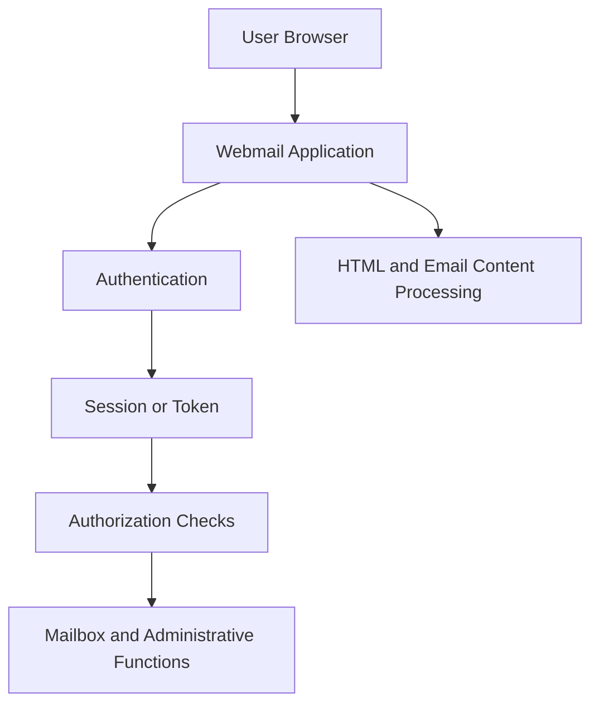

# SmarterMail Security Alert: Privilege Escalation in a Web-Based Email Platform

**Publication date:** 16 October 2026  
**Category:** Web Security · Authentication · Vulnerability Management  
**Geographic relevance:** Morocco · International software vulnerability

## 1. News Report

Morocco's national cybersecurity authority, the General Directorate for Information Systems Security (DGSSI), through its Moroccan Computer Emergency Response Team (maCERT), relayed a security alert concerning SmarterMail, a web-based email and collaboration platform.

The alert, referenced as 69421210/26 and dated 12 October 2026, concerns a privilege-escalation vulnerability. Organizations using the affected product were advised to identify relevant installations and consult the vendor's remediation guidance.

Additional international advisories published in October 2026 identify multiple vulnerabilities affecting SmarterMail versions before Build 9777. These include CVE-2026-104084, associated with insufficient session expiration and privilege handling, and CVE-2026-104083, associated with cross-site scripting.

This report examines the security concepts behind these issues. The available alert does not establish that a Moroccan organization was compromised or that the vulnerabilities were exploited in a Moroccan environment.

## 2. Technical Lecture: How Web Applications Handle Privileges

A webmail application does more than display messages. It authenticates users, manages sessions, checks permissions, processes HTML content, and provides access to sensitive data.

A simplified architecture looks like this:

Each component has a distinct responsibility.

Authentication answers: Who is this user?

Authorization answers: What is this user allowed to do?

Session management answers: Does this login state remain valid?

Content sanitization answers: Is user-controlled content safe to display in the browser?

A weakness in any one of these areas can undermine the security of the application.

## 3. Privilege Escalation Through Stale Session State

CVE-2026-104084 has been described in public vulnerability reporting as an insufficient-session-expiration issue involving privilege handling.

The underlying security concept is straightforward: a user's permissions can change, but an existing session or token may continue to carry old privilege information if the application does not revalidate it correctly.

Imagine an email platform with two roles:

- **User:** can read and send their own email.
- **Administrator:** can manage accounts and platform settings.

An administrator may be demoted to an ordinary user. If a previously issued token still grants the old administrator role, the application risks allowing permissions that should no longer exist.

A secure design must ensure that authorization reflects the user's current privileges, not merely the privileges recorded when a token was first issued.

This is a general explanation of the reported vulnerability class. The exact behavior and prerequisites should be checked against the vendor's technical advisory.

## 4. Cross-Site Scripting and Email Content

CVE-2026-104083 has been described in public vulnerability reporting as a cross-site scripting (XSS) vulnerability.

XSS occurs when an application allows untrusted content to execute as script in another user's browser context.

Email is a particularly relevant example because messages can contain HTML, links, formatting, and embedded content. A webmail application must treat message content as untrusted input, even when the message appears to come from a known sender.

If sanitization fails, malicious content may execute within the webmail application's origin. Depending on the application's protections and the user's privileges, this can put session data or account actions at risk.

XSS does not automatically mean an attacker can take over the entire server. The consequences depend on browser protections, session design, application permissions, and the vulnerability's exact behavior.

## 5. How These Vulnerability Classes Differ

**Privilege escalation** concerns gaining permissions beyond those intended for an account.

**Session-management failure** occurs when a session or token remains valid longer than intended or retains authority that should have been revoked.

**Cross-site scripting** occurs when untrusted input is processed in a way that allows unintended script execution in a user's browser.

These weaknesses may affect the same product, but they are different security problems. Each requires its own analysis and remediation.

## 6. Defensive Lessons

Organizations should inventory SmarterMail deployments, identify their exact builds, and compare them with the vendor's current security guidance.

They should also review role-change behavior, token lifetime and revocation, session invalidation, and the server's handling of untrusted HTML content.

For web application developers, the central lessons are:

- Revalidate authorization when privileges change.
- Avoid trusting stale role claims indefinitely.
- Apply context-appropriate output encoding and robust HTML sanitization.
- Use secure session expiration and revocation mechanisms.
- Test authorization boundaries with separate accounts and different privilege levels.
- Keep software updated and monitor vendor security advisories.

## 7. Evidence and Limitations

**Confirmed:** DGSSI/maCERT relayed an alert concerning a SmarterMail privilege-escalation vulnerability.

**Supported by additional public reporting:** vulnerabilities affecting SmarterMail before Build 9777 include session and privilege-handling issues as well as a cross-site scripting issue.

**Not established by this report:** a confirmed breach of a Moroccan organization, exploitation in Morocco, or a single attack chain connecting all the vulnerabilities discussed here.

## References

1. DGSSI, maCERT: https://www.dgssi.gov.ma/index.php/fr/macert
2. maCERT alert summary, reference 69421210/26: https://clrexperts.com/macert-vulnerabilite-dans-smartermail/
3. Canadian Centre for Cyber Security, SmarterTools security advisory: https://www.cyber.gc.ca/en/alerts-advisories/smartertools-security-advisory-av26-1026
4. SmarterTools release notes: https://www.smartertools.com/smartermail/release-notes/current
5. Public technical reference for CVE-2026-104084: https://cvetodo.com/cve/CVE-2026-104084
6. Public technical reference for CVE-2026-104083: https://cvetodo.com/cve/CVE-2026-104083

The vendor's current security guidance takes precedence over third-party summaries when determining affected versions and remediation.
