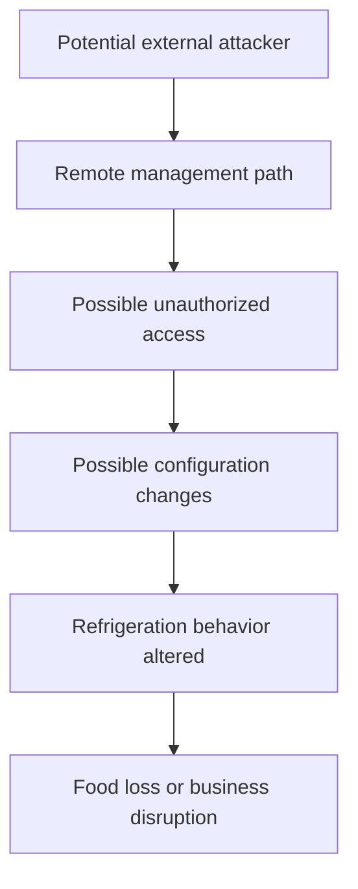

# Attack-Chain Model

The diagram below illustrates a plausible sequence for investigation. It does not claim that every step has been forensically confirmed.

## Evidence status

- Compromises of the specified controller families: confirmed by CERT-FR.
- Direct internet exposure as the initial access path in every case: not established.
- One identical attack chain across every affected store: not established.
- Physical and operational consequences: described in news reporting.

## How to validate an attack chain

For each step, record the supporting source, required prerequisites, alternative explanations, and confidence level. Update the diagram only when stronger evidence becomes available.
